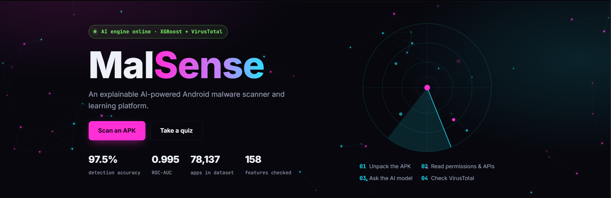

# MalSense

**An explainable AI-powered Android malware scanner and cybersecurity awareness.**

MalSense checks an Android app (APK file), tells you whether it is **benign or malware**, and explains *why* in plain language. It then turns the scanned app into a short **awareness quiz**, so users learn what the app could do and how to protect themselves.

Final Year Project, Bachelor of Computer Science (Hons.) Information Security and Assurance, Universiti Sains Islam Malaysia (USIM).

> **Live demo:** https://malsense.onrender.com (free hosting: the first visit can take about a minute to wake up)

---

## Why MalSense?

Tools tell you that an APK is malicious, but not **what it does** or **why it is dangerous**, and not what to do if you have already installed it. MalSense combines a machine-learning verdict with an explanation and a lesson built from the same app.

## Features

**Scanning and explanation**
- Extracts **158 static features** (permissions, API calls and other indicators) from an APK with **Androguard**, calculated the same way as the **KronoDroid** dataset
- **XGBoost** classifier decides benign vs malware, with a confidence score
- **Explainable AI:** per-feature SHAP contributions (XGBoost `pred_contribs`) show which features pushed the verdict towards malware or benign
- **VirusTotal** hash lookup as a second opinion (the APK itself is never uploaded), combined with the model into a final risk level and recommended action
- Lists the APK's **intents and API calls**, using the feature list from **CICMalDroid 2020**
- Downloadable scan **reports** (PDF / Word)

**Learning**
- **AI-generated awareness quiz** (Google Gemini) built from each scanned app, with a built-in question bank as fallback
- **Mobile security checklist**
- **Digital Amanah** page: digital-safety advice framed with Islamic values (Amanah, Maqasid Syariah)

**Accounts and admin**
- Registration with email verification, password reset, and **Sign in with Google** (OAuth 2.0 with PKCE)
- Personal scan history
- Admin panel: users, scan logs, ML model page, threat intelligence (IoC export), and user-reported APKs
- Guests can scan APKs right away; an account unlocks the quiz, history, reports and learning pages
- Daily limits on scans and quizzes (guests and users) to protect the API quotas
- Light / dark theme, mobile-friendly layout

## Tech stack

| Layer | Technology |
|---|---|
| Web app | Python 3.13, Flask, Jinja2 templates, HTML / CSS / vanilla JavaScript |
| Machine learning | XGBoost, scikit-learn (SVM and Random Forest baselines), pandas, NumPy |
| APK analysis | Androguard |
| AI | Google Gemini API (quiz generation) |
| Threat intelligence | VirusTotal API v3 |
| Database | MySQL locally, TiDB Cloud (MySQL-compatible) online; SQLAlchemy + PyMySQL |
| Security | Flask-Login, Flask-WTF (CSRF), bcrypt, email verification, Google OAuth |
| Email | Gmail SMTP locally, Gmail API online |
| Reports | ReportLab (PDF), python-docx (Word) |
| Hosting | Render (Gunicorn) |

## How it works

```
APK upload
   -> Androguard extracts 158 features (+ intents and API calls)
   -> XGBoost: benign / malware + confidence
   -> SHAP contributions: top reasons behind the verdict
   -> VirusTotal hash lookup (second opinion)
   -> Result page + report
   -> Gemini turns the findings into a short awareness quiz
```

The model was trained and evaluated on **KronoDroid**, comparing **SVM, Random Forest and XGBoost** over three train/test splits (70/30, 80/20, 90/10) on the same data. The training and evaluation scripts are in `src/training/` (`kd_*.py`); `src/train_scanner_model.py` builds the model the website uses. The datasets themselves are not included in this repository.

## Project structure

```
app.py               Flask routes
models.py            Database models (SQLAlchemy)
src/                 Scanner, explanation, VirusTotal, quiz, reports, email
src/training/        Data preparation and model comparison scripts (thesis experiments)
templates/  static/  Web pages, styles, fonts, images
models/              Trained scanner model used by the web app
database/            schema.sql (complete schema), tidb_setup.sql (same, for TiDB Cloud), old migrations
docs/DEPLOY.md       Deploying to Render + TiDB Cloud
tests/               Small connection checks (database, email, Gemini, Androguard)
```

## Run it locally

1. **Python 3.13** and **MySQL 8** installed.
2. Create a virtual environment and install the packages:
   ```
   python -m venv .venv
   .venv\Scripts\activate          (Windows)   |   source .venv/bin/activate   (macOS/Linux)
   pip install -r requirements.txt
   ```
3. Create the database: run `database/schema.sql` in MySQL (it creates the `malsense` database, an app user and all tables).
4. Copy `.env.example` to `.env` and fill it in. For a local MySQL use `DB_HOST=localhost`, `DB_PORT=3306`, `DB_SSL=false`, and `MAIL_PROVIDER=smtp` with a Gmail App Password. API keys: VirusTotal, Gemini, and (optional) a Google OAuth client.
5. Start it:
   ```
   python app.py
   ```
   and open http://127.0.0.1:5000. Make an account an admin with `flask --app app make-admin you@example.com`.

For the online deployment see [`docs/DEPLOY.md`](docs/DEPLOY.md).

## Safety note

Only scan APKs you are allowed to analyse, and handle real malware samples in an isolated environment. Uploaded APKs are deleted right after each scan.

## Credits

- **KronoDroid** dataset (Guerra-Manzanares et al.) - training data for the benign/malware model
- **CICMalDroid 2020** (Canadian Institute for Cybersecurity) - intent and API-call feature list
- Supervisor: Dr Norasikin, USIM

## Author

**Siti Zahra Safa Sani** (myokohi) - Information Security student, USIM
CTF writeups: https://myos-esc.gitbook.io

This is an academic project. Please contact me before reusing the code.
